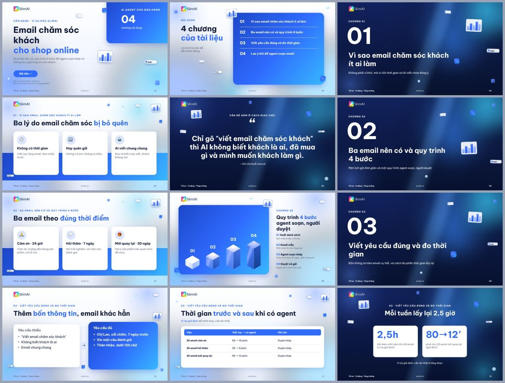
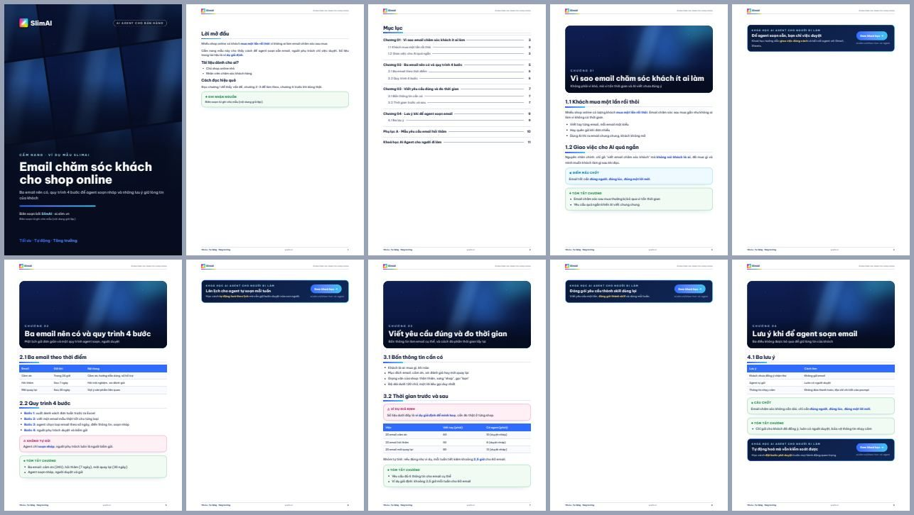
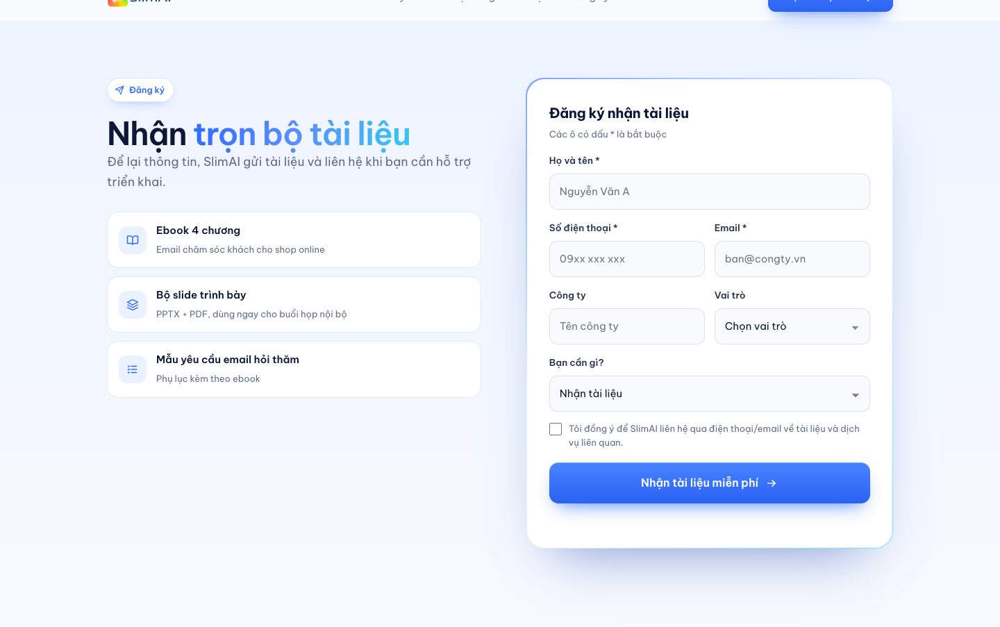

# Agent tạo Slide, Ebook và Landing page · SlimAI

Có một tài liệu thô (ghi chú họp, PDF, bài giảng, trang web) và cần biến nó thành **bộ slide để trình bày, ebook để gửi khách và landing page để thu đăng ký**? Agent này làm cả ba từ **một bản thảo chung**, cùng một phong cách thiết kế SlimAI, không cần API key khi chạy trong Claude Code hoặc Codex.

Tài liệu thực hành cho tình huống 09, [Khoá học AI Agent cho người đi làm](https://ai.slim.vn/khoa-hoc-ai-agent) của SlimAI.

| Slide (PPTX + PDF + trình chiếu HTML) | Ebook A4 (PDF) |
|---|---|
|  |  |

| Landing page — hero | Landing page — form đăng ký |
|---|---|
|  |  |

## Bắt đầu bằng một prompt

Mở Claude Code hoặc Codex tại một thư mục trống rồi dán prompt trong [PROMPT_CAI_VA_CHAY_THU.md](PROMPT_CAI_VA_CHAY_THU.md). AI tự tải repo, cài skill và chạy thử trên tài liệu mẫu.

Đã cài rồi thì chỉ cần nói: *"Dùng skill slide-ebook-agent biến tài liệu này thành bộ slide, ebook và landing page."*

## Agent làm gì

1. **Đọc nguồn** (PDF có chữ, DOCX, PPTX, Markdown, TXT, URL) → văn bản + ảnh minh hoạ.
2. **Biên soạn bản thảo chung** `ban-thao.json`: tên tài liệu (10 phương án), lời mở đầu, các chương, slide của từng chương, phụ lục — **dừng lại cho bạn duyệt**.
3. **Dựng** bộ slide 16:9 (PPTX sửa được, có chuyển cảnh Morph; PDF; bản trình chiếu HTML một tệp) và ebook A4 (bìa, mục lục, mở chương, hộp mẹo/lưu ý, box khoá học, trang hệ sinh thái).
4. **Landing page** một tệp HTML: hero có thẻ số liệu, quy trình, nội dung, biểu đồ trước/sau, khối tổng kết, **form đăng ký** gửi tới CRM/Google Sheet/webhook của bạn.
5. **Tự kiểm định**: đo chữ tràn khung, đồng bộ ebook ↔ slide, link thương hiệu, ảnh từng trang để soát.

## Trong repo có gì

| Đường dẫn | Nội dung |
|---|---|
| [`slide-ebook-agent/`](slide-ebook-agent/SKILL.md) | Skill cho Claude Code / Codex: `SKILL.md`, [cài đặt](slide-ebook-agent/INSTALL.md), mã chạy trong `slide_ebook_agent/` |
| [`slide_ebook_agent/brand_voice.md`](slide-ebook-agent/slide_ebook_agent/brand_voice.md) | Giọng thương hiệu: viết cho ai, giọng văn, tiêu đề, chữ trên nút, quy tắc sự thật |
| [`slide_ebook_agent/design_system.md`](slide-ebook-agent/slide_ebook_agent/design_system.md) | Một hệ thiết kế cho cả ba dạng: màu, chữ, thẻ kính, khối navy, thành phần, chuyển động, biểu đồ |
| [`slide_ebook_agent/BAN_THAO.md`](slide-ebook-agent/slide_ebook_agent/BAN_THAO.md) | Cấu trúc bản thảo chung (AI tự soạn khi không có API key) |
| [`slide_ebook_agent/PEAS.md`](slide-ebook-agent/slide_ebook_agent/PEAS.md) | Thiết kế tác tử theo PEAS cho từng bộ phận |
| [`slide-ebook-agent/tai-lieu-slimai/`](slide-ebook-agent/tai-lieu-slimai/README.md) | Bộ nhận diện SlimAI đóng kèm (logo, link, khoá học) và mẫu ebook A4 |
| [`vi_du/`](vi_du/) | Tài liệu nguồn mẫu, bản thảo mẫu đã duyệt, ảnh xem trước |

## PEAS trong một bảng

| Chữ | Dịch | Nhớ nhanh | Agent này |
|---|---|---|---|
| **P** · Performance measure | Thước đo hiệu quả | KPI | Bao phủ mọi ý của nguồn; **không chữ nào tràn khung**; ebook, slide, landing cùng nội dung và phong cách; 0 số liệu bịa |
| **E** · Environment | Môi trường | Bàn làm việc | Tài liệu thô nhiều định dạng, bộ nhận diện SlimAI, trình duyệt Chromium/Chrome |
| **A** · Actuators | Cơ cấu chấp hành | Đôi tay | Đọc, biên soạn, dựng PPTX/PDF/HTML, đo chữ, kiểm định. **Không** gửi, đăng hay chia sẻ tệp; không bịa số liệu, khách hàng, giá |
| **S** · Sensors | Cảm biến | Đôi mắt | Nội dung và ảnh nguồn, kích thước chữ đo trong trình duyệt, báo cáo kiểm định |

## Phong cách

Mặc định **SaaS xanh dương** cho cả ba dạng (xem [design_system.md](slide-ebook-agent/slide_ebook_agent/design_system.md)). Chọn khác khi cần: `--phong-cach retron` (tím gradient, khối lập phương 3D), `visual` (theo bảng màu tài liệu), `co-dien`; hoặc đổi màu bằng `--bang-mau "#chính,#phụ,#đậm,#nền,#chữ"`.

## Lưu ý

- Tài liệu mẫu trong `vi_du/` là **nội dung giả lập**; số liệu là ví dụ giả định.
- Form landing page chỉ gửi dữ liệu khi bạn cấu hình `--form-action`; chưa cấu hình thì trang báo rõ là bản xem trước.
- Ảnh lấy từ tài liệu nguồn thuộc về tác giả gốc — kiểm tra quyền trước khi phát hành.
- Logo và nhận diện SlimAI chỉ dùng cho tài liệu của SlimAI. Font Be Vietnam Pro theo SIL Open Font License 1.1.
